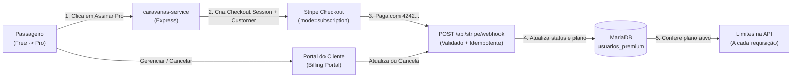
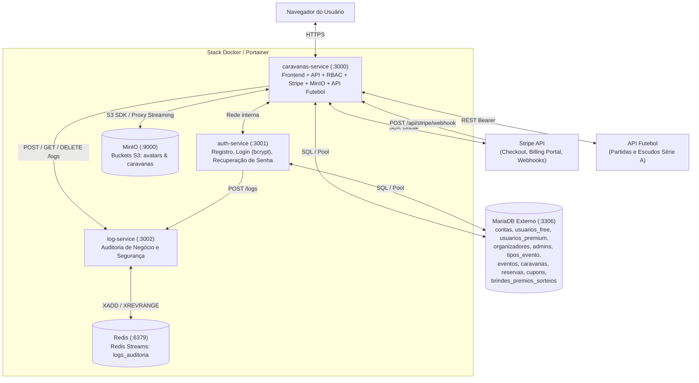

# 🚌 Caravana's Hub — SaaS Completo de Caravanas Esportivas da Alta Paulista

> **Disciplina:** ISW055 — Introdução à Computação em Nuvem  
> **Atividade:** Atividade 11 — Assinatura recorrente: SaaS completo — planos, limites e assinatura com Stripe  
> **Professor:** [@siriani](https://github.com/siriani) (`github.com/siriani`)  
> **Endereço público (Stack Portainer):** [https://yago-martins-isw055.lapps.studio](https://yago-martins-isw055.lapps.studio)

---

## 1. Proposta de Negócio e Dor Resolvida

Torcedores e fãs de esporte que moram no interior de São Paulo — especificamente nas **18 cidades da Alta Paulista** (*Marília, Tupã, Adamantina, Dracena, Osvaldo Cruz, Garça, Pompeia, Lucélia, Bastos, Junqueirópolis, Parapuã, Rinópolis, Vera Cruz, Herculândia, Quintana, Pacaembu, Inúbia Paulista e Flórida Paulista*) — enfrentam grandes dificuldades logísticas para assistir ao seu time, piloto ou lutador ao vivo nas capitais.

O **Caravana's Hub** resolve essa dor operando como um **SaaS organizador de caravanas esportivas** (vans e ônibus executivos) para **Futebol**, **Fórmula 1** e **MMA**:
- **Ingresso incluso a preço de custo:** a plataforma não revende ingressos com ágio (prática ilegal de cambismo). O ingresso oficial entra na composição da passagem exatamente pelo preço de face.
- **Transparência tarifária (margem na logística):** o lucro da operação vem exclusivamente do transporte rodoviário, calculado sobre distância (ida e volta), consumo de diesel, motorista e pedágios:
  $$\text{Custo da Viagem} = \left(\frac{2 \times \text{km}}{\text{km/L}}\right) \times \text{Preço do Diesel} + \text{Motorista e Pedágios}$$
  $$\text{Passagem por Lugar} = \left(\frac{\text{Custo da Viagem}}{\text{Vagas}} \times 1{,}20\right) + \text{Ingresso a Preço de Custo}$$

---

## 2. Modelo de Receita — Planos, Preços e Limites na API (Stripe Modo de Teste)

Os dois planos estão configurados no **Stripe em modo de teste** com cobrança recorrente mensal em Reais (`BRL`). Tudo o que o plano **Free** não pode fazer é **barrado diretamente no backend (API)** com status `HTTP 403` e mensagem explicativa orientando como liberar o recurso assinando o **Pro**:

| Recurso / Limite na API | Plano **Free** (`R$ 0,00 / mês`) | Plano **Pro** (`R$ 19,90 / mês` — Stripe) | Como a API impõe o limite |
| :--- | :--- | :--- | :--- |
| **Reservas de caravanas por mês** | Até **2 reservas/mês** (`LIMITE_RESERVAS_MES_FREE=2`) | **Reservas ilimitadas** no mês | Na 3ª tentativa no mês, `POST /api/reservas` recusa com `403` informando o limite gratuito (2/mês) e sugerindo o upgrade para o Pro (`R$ 19,90/mês`), gravando `limite_free_atingido` no log. |
| **Janela de compra (Pré-venda)** | Somente na **abertura geral** (`abertura_vendas_em`) | **Pré-venda exclusiva 3 dias antes** (`ANTECEDENCIA_PRO_DIAS=3`) | Caravanas em pré-venda ficam ocultas na listagem Free e, se chamadas via `POST /api/reservas`, retornam `403` (`limite_prevenda_pro`). |
| **Cupons de desconto na viagem** | Bloqueado (`HTTP 403`) | **Cupons exclusivos** (até 50% de desconto na fração de transporte) | Se um usuário Free informar código de cupom em `POST /api/reservas`, o backend recusa com `403`. |
| **Sorteios de brindes oficiais** | Elegibilidade básica | **Prioridade e elegibilidade Pro** (camisas oficiais, bonés, kits) | Registrado nas chaves tipadas `ganhador_premium_id` / `ganhador_free_id`. |
| **Upload de avatar (MinIO)** | Limite de **2 MB** por imagem | Limite expandido de **10 MB** por imagem | Validado em `POST /api/perfil/avatar` conforme `req.usuario.pro`. |
| **Gestão da assinatura** | Upgrade via Stripe Checkout (`mode=subscription`) | **Portal do Cliente (Stripe Billing Portal)** + cancelamento | `POST /api/stripe/portal` abre o Billing Portal oficial do Stripe para troca de cartão/plano ou cancelamento. |

---

## 3. Ciclo de Vida da Assinatura Recorrente com Stripe

O plano do usuário nasce no **Free** (`usuarios_free`) no momento do cadastro e muda **sozinho** no banco de dados (`usuarios_premium`) conforme os eventos assinados enviados pelo Stripe ao endpoint `POST /api/stripe/webhook`.



### 3.1. Os 4 Webhooks do Stripe Mantendo o Plano no Banco

O endpoint `POST /api/stripe/webhook` recebe o corpo bruto (`express.raw({ type: 'application/json' })`) **antes** do `express.json()`, valida o cabeçalho `stripe-signature` com `STRIPE_WEBHOOK_SECRET` (`stripe.webhooks.constructEvent`) e garante **idempotência** por `event.id` (`eventosWebhookProcessados`), evitando efeito duplicado caso o Stripe reenvie o mesmo evento:

| Evento (Webhook) | Quando chega | O que o `caravanas-service` faz no banco e no log |
| :--- | :--- | :--- |
| **`checkout.session.completed`** | O cliente acabou de pagar no Checkout (`mode=subscription` ou passagem avulsa `mode=payment`). | Guarda no usuário o `stripe_customer_id` e o `stripe_subscription_id`, define `status_assinatura = 'active'` e `ativo = 1` em `usuarios_premium` e registra `upgrade_pro` no `log-service`. |
| **`customer.subscription.updated`** | O cliente trocou de plano, renovou ou o status da assinatura mudou no Stripe (`active`, `past_due`, `canceled`…). | Atualiza `stripe_subscription_id`, `status_assinatura` e `ativo` (`1` para `active`/`trialing`, `0` para os demais) e registra `assinatura_atualizada` no `log-service`. |
| **`customer.subscription.deleted`** | A assinatura foi cancelada pelo cliente (no Portal ou no app) ou expirou definitivamente. | Define `ativo = 0` e `status_assinatura = 'canceled'` em `usuarios_premium`, garante o vínculo em `usuarios_free` e registra `assinatura_cancelada_webhook`. |
| **`invoice.payment_failed`** | A cobrança mensal da renovação falhou no cartão do assinante. | Marca `status_assinatura = 'past_due'` e **`ativo = 0`** (o Pro não continua de graça), retorna o usuário para os limites do Free, exibe alerta de inadimplência na tela Pro e registra `pagamento_renovacao_falhou`. |

### 3.2. Portal do Cliente (Stripe Billing Portal)

Na aba **Pro & Cupons**, o assinante possui o botão **"Gerenciar assinatura (Portal do Cliente Stripe)"**, que aciona `POST /api/stripe/portal`. O backend chama `stripe.billingPortal.sessions.create` passando o `stripe_customer_id` salvo no banco e redireciona o usuário para o portal hospedado pelo Stripe (em modo de teste), onde ele pode atualizar o método de pagamento, consultar faturas ou cancelar a assinatura autonomamente.

---

## 4. Painel Admin e Métricas SaaS

Exclusivo para contas com papel `admin` (protegido pelo middleware `somenteAdmin` no backend e autenticado exclusivamente via atalho oculto `F2` na página inicial), o painel consulta `GET /api/admin/metricas-saas` e exibe em tempo real:

1. **Usuários em cada plano:** contagem exata de contas no plano **Free** vs contas no plano **Pro**.
2. **Assinaturas ativas:** total de assinaturas com `ativo = 1` no Stripe, além do acompanhamento de assinaturas inadimplentes (`past_due`) e canceladas (`canceled`).
3. **MRR de teste (*Monthly Recurring Revenue*):** soma do valor mensal das assinaturas ativas ($\text{Assinaturas Ativas} \times \text{R\$ 19,90}$).
4. **Últimos eventos do log:** stream em tempo real dos eventos de negócio e webhooks gravados no **Redis Streams** pelo `log-service` (`upgrade_pro`, `assinatura_atualizada`, `assinatura_cancelada_webhook`, `pagamento_renovacao_falhou`, `limite_free_atingido`, `vaga_reservada`, `tentativa_negada_403`, etc.).

---

## 5. Arquitetura de Microsserviços

A aplicação mantém a mesma stack de containers no Portainer (respeitando o limite de 1 GB de RAM por container e utilizando o mesmo subdomínio):



---

## 6. Modelagem de Dados (`db/001_dominio.sql`)

O script idempotente [db/001_dominio.sql](file:///c:/Faculdade/Caravanas-Hub-main/db/001_dominio.sql) remove as tabelas do domínio antigo (`comentarios`, `favoritos`) e estrutura o banco com integridade referencial, `CHECK` constraints e `TRIGGER` para corridas:

1. **`contas`**: identidade central de login (`id`, `nome`, `email`, `senha_hash`, `papel` ENUM `'passageiro' | 'organizador' | 'admin'`, `time_torcida`, `avatar_url`).
2. **`usuarios_free`** e **`usuarios_premium`**: especializações de plano referenciando `contas(id)`. A tabela `usuarios_premium` armazena `stripe_customer_id`, `stripe_subscription_id`, `status_assinatura` (`'active'`, `'past_due'`, `'canceled'`, `'incomplete'`) e `ativo`.
3. **`organizadores`** e **`admins`**: dados de frota/contato dos organizadores e nível/setor dos administradores.
4. **`tipos_evento`** e **`eventos`**: modalidades (`futebol`, `corrida` restrita a admin, `mma`), com `TRIGGER` `trg_eventos_uma_corrida_brasil_ins` garantindo no máximo 1 corrida de Fórmula 1 por ano no Brasil.
5. **`caravanas`**: viagens com saída das 18 cidades da Alta Paulista (`vagas_totais`, `preco`, `data_saida`, `local_saida`, `cidade_saida`, `abertura_vendas_em`, `foto_url`, `status`).
6. **`reservas`**: passagens vinculadas a `usuario_free_id` **ou** `usuario_premium_id` (`CHECK (num_nonnulls(usuario_free_id, usuario_premium_id) = 1)`), com controle de sessão/pagamento do Stripe e estorno automático em caso de cancelamento.
7. **`cupons`** e **`brindes_premios_sorteios`**: cupons percentuais exclusivos para `usuarios_premium` e histórico de sorteios das caravanas.

---

## 7. Papéis (RBAC — Padrão A) e Isolamento Multi-Tenant

O papel e o plano do usuário são conferidos diretamente no MariaDB a cada requisição (`carregarUsuario`):

- **`passageiro` (padrão no registro):**
  - Visualiza caravanas abertas (respeitando a janela de antecedência de 3 dias do Pro), escolhe seu esporte/time do coração, reserva passagens (até 2/mês no Free; ilimitadas no Pro) e gerencia suas próprias reservas e assinatura.
  - **Isolamento Multi-Tenant:** `GET /api/reservas`, `GET /api/reservas/:id` e `DELETE /api/reservas/:id` filtram estritamente pelo `dono_id`. Tentativas de acesso a reservas de terceiros retornam `403` e geram o evento `tentativa_acesso_reserva_alheia` no `log-service`.
- **`organizador`:**
  - Cria, edita, cancela e envia fotos (MinIO) **apenas das suas próprias caravanas** (`c.organizador_id === req.usuario.id`) e consulta a lista de passageiros de suas viagens. Não pode cadastrar corridas de Fórmula 1 (`403`).
- **`admin`:**
  - Autenticação restrita via atalho oculto `F2` na página inicial (`via_atalho_f2`).
  - Acesso completo às métricas SaaS (`GET /api/admin/metricas-saas`), gestão de caravanas, importação de partidas da API Futebol, cadastro de corridas de F1, promoção/remoção de plano Pro, emissão de cupons de desconto, sorteio de brindes e auditoria de logs.

---

## 8. Roteiro de Teste (Passo a Passo)

1. **Cadastro no plano Free:**
   - Acesse `/auth.html?modo=cadastro`, crie uma conta de passageiro e escolha seu esporte/time favorito no modal de boas-vindas. A conta nasce automaticamente no plano **Free** (`R$ 0,00`).
2. **Teste do limite do plano Free na API:**
   - No plano Free, inicie **2 reservas** em caravanas abertas.
   - Ao tentar fazer a **3ª reserva no mesmo mês** (ou tentar aplicar um cupom Pro / reservar uma caravana em pré-venda Pro), observe a API recusar com `HTTP 403` informando claramente o limite gratuito de 2 reservas/mês e convidando para assinar o Pro.
3. **Upgrade para o Pro via Stripe Checkout (`mode=subscription`):**
   - Abra a aba **Pro & Cupons** e clique em **"Assinar com Stripe (R$ 19,90/mês)"**.
   - No Stripe Checkout (modo de teste), pague com o cartão `4242 4242 4242 4242` (qualquer validade futura e CVC).
   - O webhook `checkout.session.completed` (e a verificação de retorno) grava `stripe_customer_id` e `stripe_subscription_id` no banco e ativa o plano **Pro** sem precisar relogar.
4. **Uso dos recursos liberados no Pro:**
   - Com o Pro ativo, faça a **3ª reserva no mês** normalmente (limite mensal liberado), visualize caravanas em pré-venda exclusiva (3 dias antes) e aplique cupons de desconto emitidos pelo administrador.
5. **Portal do Cliente (Billing Portal) e Cancelamento:**
   - Na aba **Pro & Cupons**, clique em **"Gerenciar assinatura (Portal do Cliente Stripe)"** para abrir o Billing Portal oficial do Stripe, ou clique em **"Cancelar assinatura Pro"**.
   - Ao cancelar, o webhook `customer.subscription.deleted` (ou o endpoint de cancelamento) retorna a conta para o plano **Free** e restaura imediatamente as travas na API.
6. **Painel Admin e MRR de Teste:**
   - Na página inicial (`/`), pressione a tecla **`F2`** para abrir o modal restrito de autenticação do administrador.
   - Acesse o **Painel do Administrador** para visualizar os indicadores de **Usuários por Plano (Free vs Pro)**, **Assinaturas Ativas**, **MRR de Teste** (`assinaturas_ativas × R$ 19,90`), emitir cupons de desconto e auditar os eventos gravados no Redis Streams.

---

## 9. Variáveis de Ambiente (`.env.example`)

Nenhuma chave secreta do Stripe está versionada no repositório. As chaves reais ficam exclusivamente nas variáveis da stack no Portainer, e o arquivo [.env.example](file:///c:/Faculdade/Caravanas-Hub-main/.env.example) documenta todas as variáveis exigidas:

```env
PORT=3000
API_FUTEBOL_KEY=sua_chave_aqui
ANTECEDENCIA_PRO_DIAS=3
LIMITE_RESERVAS_MES_FREE=2
APP_URL=https://yago-martins-isw055.lapps.studio

DB_HOST=35.226.64.52
DB_USER=IAC_2026_02_yago_martins
DB_PASSWORD=sua_senha
DB_NAME=IAC_2026_02_yago_martins
DB_PORT=3306
SESSION_SECRET=segredo_da_sessao_super_seguro

# Stripe (Modo de Teste)
STRIPE_PUBLISHABLE_KEY=pk_test_...
STRIPE_SECRET_KEY=sk_test_...
STRIPE_WEBHOOK_SECRET=whsec_...
STRIPE_PRICE_ID=

# MinIO
MINIO_ENDPOINT=minio
MINIO_PORT=9000
MINIO_PORT_PUBLIC=9003
MINIO_ACCESS_KEY=ademiro
MINIO_SECRET_KEY=szoboslai

# Brevo SMTP
SMTP_USER=
SMTP_PASS=
```
