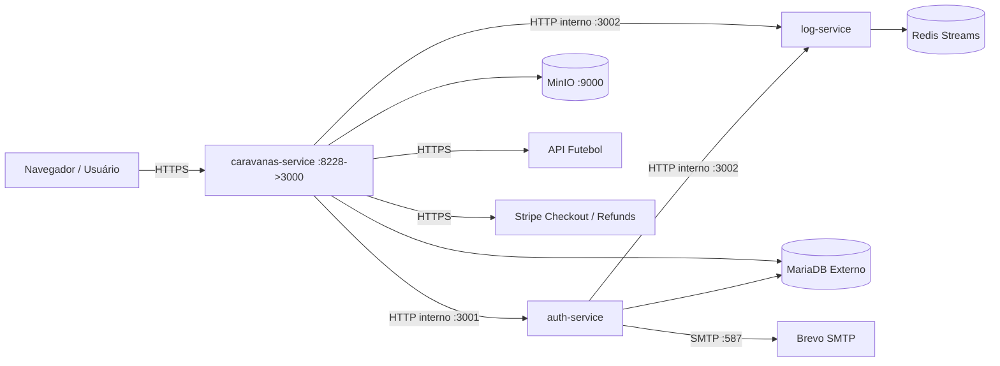

# Caravana's Hub

Aplicação web em microsserviços para organização de caravanas esportivas (**Futebol, Fórmula 1 e MMA**) com saídas exclusivas da **Alta Paulista** e passagem com **ingresso incluso a preço de custo**.

- **Professor:** [@siriani](https://github.com/siriani)
- **Disciplina:** ISW055 — Introdução à Computação em Nuvem
- **URL em produção:** https://yago-martins-isw055.lapps.studio

---

## Proposta de Negócio
- **Dor resolvida:** torcedores e fãs do interior (Alta Paulista) frequentemente ficam impossibilitados de assistir a jogos, corridas e lutas ao vivo pela dificuldade de deslocamento e compra de ingressos.
- **Modelo de receita:** o ingresso é repassado **a preço de custo** (sem ágio); o lucro da operação vem exclusivamente do frete da viagem (combustível ida e volta, motorista, pedágios e margem operacional divididos pelas vagas).
- **Planos:**
  - **Free:** cadastro gratuito e compra de passagem com ingresso incluso via Stripe Checkout (modo teste).
  - **Pro (Assinatura Stripe):** acesso antecipado às caravanas (**3 dias antes** do plano Free), cupons de desconto exclusivos emitidos pelo administrador e participação em sorteios de brindes e prêmios.

---

## Arquitetura do Sistema



### Serviços
- **`caravanas-service`** (`caravanas-hub-yago`): único ponto de entrada público (porta `8228` -> `3000`). Serve a landing page (`index.html`), o painel web (`app.html`), as APIs CRUD de caravanas, eventos, reservas, cupons e brindes, proxy de mídia do MinIO, integração com a **API Futebol** e **Stripe Checkout** (assinatura Pro e pagamento único de passagem com estorno automático no cancelamento).
- **`auth-service`** (`auth-service-yago`): container interno (porta `3001`, sem porta exposta). Responsável por cadastro (`contas` + `usuarios_free`), login com `bcrypt`, gestão de papéis (`passageiro`, `organizador`, `admin`) e recuperação de senha via Brevo SMTP (`reset_tokens`).
- **`log-service`** (`log-service-yago`): container interno (porta `3002`). Persiste eventos de negócio e segurança no **Redis Streams** (`auditoria:logs`).
- **`minio`** (`minio-storage`): object storage S3 compatível para fotos das vans/ônibus das caravanas (bucket `caravanas`) e avatares dos usuários (bucket `avatars`).
- **`MariaDB` externo**: banco relacional criado e semeado pelo script versionado [`db/001_dominio.sql`](./db/001_dominio.sql).

---

## Papéis (RBAC) e Isolamento Multi-Tenant
1. **`passageiro`**: visualiza caravanas (respeitando a janela de antecedência Free vs Pro), compra passagens, vê e cancela **apenas as próprias** reservas. Tentar abrir reserva de outro usuário retorna `403` e registra auditoria.
2. **`organizador`**: pode cadastrar eventos de futebol/MMA, criar/editar/cancelar **apenas as próprias** caravanas, subir foto do veículo no MinIO e visualizar a lista de passageiros das suas caravanas. Tentar cadastrar corrida de F1 ou editar caravana de outro organizador retorna `403`.
3. **`admin`**: acesso completo, incluindo cadastro de corridas de F1 (com trigger SQL garantindo no máximo 1 corrida no Brasil por ano), gestão de papéis, emissão de cupons para assinantes Pro, sorteio de brindes e consulta/exclusão dos logs no Redis.

---

## Eventos de Negócio Auditados (`log-service`)
- Autenticação: `cadastro_sucesso`, `login_sucesso`, `login_falha`, `logout`, `solicitacao_recuperacao_senha`, `senha_redefinida`, `senha_alterada`.
- Negócio: `caravana_criada`, `caravana_editada`, `caravana_cancelada`, `caravana_removida`, `foto_caravana_enviada`, `evento_criado`, `evento_importado_api`, `reserva_iniciada`, `vaga_reservada`, `reserva_cancelada`, `reserva_expirada`, `pagamento_estornado`, `upgrade_pro`, `cancelar_pro`, `cupom_gerado`, `cupom_aplicado`, `brinde_sorteado`.
- Segurança: `tentativa_negada_403`, `tentativa_acesso_reserva_alheia`, `papel_alterado`.

---

## Como Executar Localmente
1. Clone o repositório.
2. Copie `.env.example` para `.env` e preencha `DB_PASSWORD`, `SESSION_SECRET`, `API_FUTEBOL_KEY`, `STRIPE_*` e `SMTP_*`.
3. Suba a stack com Docker:
   ```bash
   docker compose up --build -d
   ```
4. O `caravanas-service` executa automaticamente o script [`db/001_dominio.sql`](./db/001_dominio.sql) na inicialização. Para rodar manualmente no MariaDB:
   ```bash
   mysql -h <host> -u <user> -p <database> < db/001_dominio.sql
   ```
5. Acesse `http://localhost:8228` (landing page pública).
